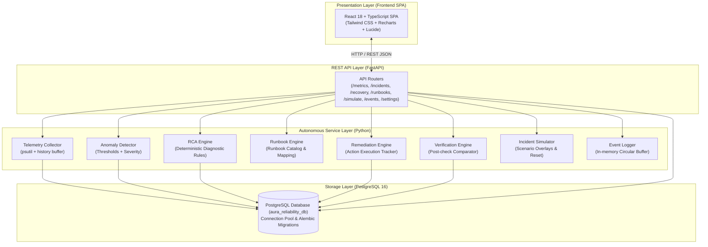
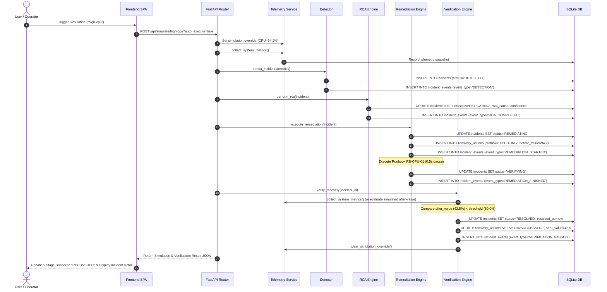

# System Design Document
## Project: AURA — Autonomous Reliability Agent
**Document Version:** 1.0.0  
**Focus:** Software Architecture, Component Design, Data Flow, Design Decisions & Scalability

---

## 1. Architecture Overview

AURA is designed around a clean, layered architectural model that cleanly separates presentation, RESTful API routing, autonomous business services, and local persistence.



---

## 2. Component Design

Each backend component has a single, well-defined responsibility with decoupled inputs and outputs.

### 2.1 Telemetry Collector (`services/telemetry.py`)
- **Responsibility:** Periodically samples host CPU, memory, disk, and network transfer rates via `psutil`. Applies in-memory simulation overrides when active. Persists telemetry snapshots for frontend real-time graphs.
- **Inputs:** OS performance counters (`psutil.cpu_percent()`, `virtual_memory()`, `disk_usage()`, `net_io_counters()`, `boot_time()`) and `_simulation_state` overlay dict.
- **Processing:** Normalizes percentages, computes network throughput deltas ($\text{MB/s}$), formats human-readable uptime, determines overall system status (`HEALTHY`, `WARNING`, `CRITICAL`), and inserts rolling records into `telemetry_history` (pruning records beyond 100).
- **Outputs:** `SystemMetrics` payload dictionary.
- **Dependencies:** `psutil`, `database.py`, `utils/logger.py`.

### 2.2 Incident Detection Engine (`services/detector.py`)
- **Responsibility:** Evaluates incoming telemetry against dynamic thresholds stored in `system_settings` and creates new incident records.
- **Inputs:** `SystemMetrics` dict, `sim_error_log` optional string.
- **Processing:** Compares values against CPU ($80\%$), RAM ($85\%$), Disk ($90\%$) thresholds. Assigns severity (`CRITICAL` vs `HIGH`). Checks database to ensure no duplicate active incident is already open for that metric. Generates `INC-XXX` identifier, inserts record into `incidents`, and logs an initial `DETECTION` event in `incident_events`.
- **Outputs:** Newly created incident dict or `None` if healthy/suppressed.
- **Dependencies:** `database.py`, `utils/logger.py`.

### 2.3 Root Cause Analysis (RCA) Engine (`services/rca.py`)
- **Responsibility:** Performs deterministic diagnosis to explain why an incident occurred, producing evidence and recommended remediation actions.
- **Inputs:** Incident dictionary (`id`, `metric`, `current_value`, `threshold`, `type`).
- **Processing:** Evaluates metric type and value against deterministic heuristic rules:
  - `cpu`: "CPU-intensive background worker process", confidence $94\%$, recommends `RB-CPU-01`.
  - `memory`: "Memory leak in application query cache buffer", confidence $91\%$, recommends `RB-MEM-02`.
  - `disk`: "Log file volume exhaustion in temporary storage partition", confidence $96\%$, recommends `RB-DISK-04`.
  - `app_health`: "Database connection pool timeout & deadlocked session", confidence $89\%$, recommends `RB-APP-03`.
  Updates incident in SQLite (`status = 'INVESTIGATING'`) and appends `RCA_COMPLETED` event to `incident_events`.
- **Outputs:** Structured RCA result (`root_cause`, `confidence`, `evidence`, `recommended_action`).
- **Dependencies:** `database.py`, `utils/logger.py`.

### 2.4 Runbook Engine (`services/runbook.py`)
- **Responsibility:** Maintains the catalog of executable recovery runbooks and maps incidents to the optimal runbook ID.
- **Inputs:** Incident dictionary.
- **Processing:** Looks up static catalog dictionary (`RUNBOOK_CATALOG`) containing `RB-CPU-01`, `RB-MEM-02`, `RB-APP-03`, `RB-DISK-04` with trigger conditions, actions, verification conditions, and success/failure criteria.
- **Outputs:** Matched `Runbook` object.
- **Dependencies:** `utils/logger.py`.

### 2.5 Automated Remediation Service (`services/remediation.py`)
- **Responsibility:** Executes runbook actions and updates the incident lifecycle state.
- **Inputs:** Incident dictionary.
- **Processing:** Transitions incident status to `REMEDIATING`. Inserts record into `recovery_actions` with `before_value` and start timestamp. Adds `REMEDIATION_STARTED` event. Simulates execution execution time ($0.5\text{s}$). Transitions incident status to `VERIFYING` and appends `REMEDIATION_FINISHED` event.
- **Outputs:** Remediation audit record (`action_id`, `incident_id`, `runbook`, `status = 'COMPLETED'`).
- **Dependencies:** `services/runbook.py`, `database.py`, `utils/logger.py`.

### 2.6 Recovery Verification Service (`services/verification.py`)
- **Responsibility:** Closes the automation loop by re-measuring the affected metric post-remediation and establishing whether the system actually recovered.
- **Inputs:** `incident_id`, `is_failure_scenario` boolean flag.
- **Processing:** Reads incident details from database. Samples fresh metric (or evaluates simulation post-value).
  - If `after_value < threshold`: Sets incident status to `RESOLVED`, records `resolved_at`, marks recovery action `SUCCESSFUL`, logs `VERIFICATION_PASSED` event, clears simulation overlay.
  - If `after_value >= threshold`: Sets incident status to `FAILED`, marks recovery action `FAILED`, logs `VERIFICATION_FAILED` event, logs `ESCALATED` event to alert on-call human engineers.
- **Outputs:** Verification result dictionary (`is_recovered`, `status`, `before_value`, `after_value`, `message`).
- **Dependencies:** `services/telemetry.py`, `database.py`, `utils/logger.py`.

### 2.7 Incident Simulator Service (`services/simulator.py`)
- **Responsibility:** Injects safe, synthetic metric spikes and error conditions for interactive demonstrations and automated testing.
- **Inputs:** Scenario name (`high-cpu`, `high-memory`, `application-failure`, `recovery-failure`), `auto_execute_loop` boolean.
- **Processing:** Sets simulation state overlay in `telemetry.py`, collects metrics, invokes detector, and (if auto-execute is enabled) executes the full `Observe` $\to$ `Detect` $\to$ `Diagnose` $\to$ `Remediate` $\to$ `Verify` pipeline synchronously.
- **Outputs:** Simulation response dictionary with incident ID and step results.
- **Dependencies:** `services/telemetry.py`, `services/detector.py`, `services/rca.py`, `services/remediation.py`, `services/verification.py`.

### 2.8 Database Access Layer (`database.py`)
- **Responsibility:** Thread-safe SQLite connection management and schema migration.
- **Features:** Context manager (`get_db()`) ensuring transactions commit on completion or rollback on exception. Enables `PRAGMA journal_mode=WAL;`, `PRAGMA synchronous=NORMAL;`, and `PRAGMA foreign_keys=ON;`.

---

## 3. Data Flow & Incident Lifecycle

The lifecycle of an incident in AURA progresses through an explicit finite state machine:

```
                  +--------------------------------+
                  |            HEALTHY             |
                  +--------------------------------+
                                  |
                                  | Metric > Threshold (e.g. CPU=94.2%)
                                  v
                  +--------------------------------+
                  |            DETECTED            |
                  +--------------------------------+
                                  |
                                  | perform_rca()
                                  v
                  +--------------------------------+
                  |         INVESTIGATING          |
                  +--------------------------------+
                                  |
                                  | execute_remediation()
                                  v
                  +--------------------------------+
                  |          REMEDIATING           |
                  +--------------------------------+
                                  |
                                  | Action Completed
                                  v
                  +--------------------------------+
                  |           VERIFYING            |
                  +--------------------------------+
                                 /  \
     after_value < threshold    /    \    after_value >= threshold
                               /      \
                              v        v
         +------------------------+  +------------------------+
         |        RESOLVED        |  |         FAILED         |
         |  (Recovery Successful) |  |   (Auto-Escalated)     |
         +------------------------+  +------------------------+
```

### Concrete Execution Example (High CPU Incident)
1. **Observe:** Host CPU is sampled at $94.2\%$.
2. **Detect:** Detection engine finds $94.2\% > 80.0\%$. Creates `INC-001` with severity `CRITICAL` and status `DETECTED`. Timeline event `DETECTION` is logged.
3. **Diagnose:** RCA engine analyzes `INC-001`. Determines cause: *"CPU-intensive background worker process"* ($94\%$ confidence). Recommends `RB-CPU-01`. Status updates to `INVESTIGATING`. Event `RCA_COMPLETED` is logged.
4. **Remediate:** Remediation engine selects `RB-CPU-01` (*"Restart CPU-intensive worker process"*). Status updates to `REMEDIATING`. Action record inserted with `before_value = 94.2`. Event `REMEDIATION_STARTED` is logged.
5. **Verify:** Action finishes, status updates to `VERIFYING`. Verification engine samples post-remediation metric: `after_value = 42.5%`.
6. **Resolve:** Verification engine notes $42.5\% < 80.0\%$. Updates incident to `RESOLVED`, recovery action to `SUCCESSFUL`, logs `VERIFICATION_PASSED`, and clears simulation.

---

## 4. Sequence Diagram



---

## 5. Error Handling Strategy

| Scenario | Potential Failure | Handling & Mitigation Strategy |
| :--- | :--- | :--- |
| **Telemetry Sampling** | `psutil` raises permissions or OS counter read exception | Caught with `try/except` block; returns safe default metrics ($20\%$ CPU, $55\%$ RAM, $45\%$ Disk) and logs warning event. Prevents application crash. |
| **Database Transactions** | Concurrent write or SQL constraint violation | Handled via `database.py`'s `get_db()` context manager. Automatically invokes `conn.rollback()` on error and raises exception cleanly. |
| **Missing Incident Lookup** | User requests `/api/incidents/{invalid_id}` | Router checks record existence; raises `HTTPException(status_code=404, detail="Incident not found.")`. |
| **Runbook Execution** | Unknown or unmapped incident type | Fallback logic selects default runbook `RB-CPU-01` with a conservative confidence score ($80\%$) and alerts on-call. |
| **Verification Failure** | Metric remains elevated ($> \text{threshold}$) post-action | Sets incident status to `FAILED`, updates recovery action to `FAILED`, and logs an `ESCALATED` event in the audit trail to flag manual intervention. |
| **Alert Storm Prevention** | Metric continues to breach threshold across multiple polling cycles | `detector.py` queries database for active unresolved incidents on that metric. If found, new creation is suppressed until previous incident resolves. |

---

## 6. Design Decisions & Trade-Offs

### 6.1 Backend Framework: FastAPI (Python)
- **Decision:** Use FastAPI with Pydantic for the backend REST API.
- **Reason:** Provides native asynchronous capabilities, automatic OpenAPI schema documentation (`/docs`), strong type validation via Pydantic, and fast execution speeds.
- **Trade-Off:** Requires Python runtime and async-aware testing libraries (`httpx`), but drastically reduces boilerplate compared to Flask or Django.

### 6.2 Frontend Architecture: React 18 + TypeScript + Tailwind CSS
- **Decision:** Use React 18 with TypeScript and Tailwind CSS bundled via Vite.
- **Reason:** TypeScript prevents runtime UI errors; Tailwind provides a clean, responsive dark-mode SRE UI; Recharts provides smooth historical telemetry line charts.
- **Trade-Off:** Requires a build step (`npm run build`), but allows delivering a single compiled `frontend/dist` directory hosted directly by FastAPI.

### 6.3 Database Engine: PostgreSQL 16 with Connection Pooling
- **Decision:** Use PostgreSQL 16 with psycopg2/psycopg3 connection pooling (`ThreadedConnectionPool`) and Alembic migrations.
- **Reason:** Provides robust relational ACID compliance, foreign key cascade constraints, high-concurrency read/write capability without file lock contention, and full Docker container integration.
- **Trade-Off:** Requires a running PostgreSQL instance (handled easily via Docker Compose or local installation) compared to a local single-file database.

### 6.4 Metrics Collection: `psutil` vs OS Shell Commands
- **Decision:** Use Python's cross-platform `psutil` library.
- **Reason:** Standardized, high-performance C-extension bindings for Windows and Linux performance counters without spawning shell sub-processes (`wmic` / `top`).
- **Trade-Off:** Adds a lightweight C-dependency during `pip install`, but ensures cross-platform consistency.

### 6.5 Diagnostic Engine: Deterministic Rule-Based vs Machine Learning / LLMs
- **Decision:** Use deterministic heuristic rule sets with explicit evidence formatting.
- **Reason:** $100\%$ explainable, predictable, fast ($< 1\text{ ms}$), testable in unit test suites, and eliminates hallucination or probabilistic non-determinism during technical interviews.
- **Trade-Off:** Limited to known, pre-categorized incident signatures, but provides reliable demonstration of closed-loop automation.

---

## 7. Scalability & Evolution Path

| Layer | Current Implementation (AURA) | Future Scaled Architecture |
| :--- | :--- | :--- |
| **Telemetry Ingestion** | Local `psutil` polling every 2s | Distributed OpenTelemetry collectors streaming metrics via Apache Kafka or NATS. |
| **Storage Layer** | Single SQLite file (`aura.db`) with WAL mode | PostgreSQL with TimescaleDB extension for high-throughput time-series telemetry. |
| **RCA Engine** | Deterministic rule matching | Hybrid engine: Rule-based fast path combined with LLM log summarization and ML anomaly detection (e.g., Isolation Forests). |
| **Remediation Execution** | Local simulated action handler | Kubernetes Operator / Ansible automation engine executing remote container restarts, pod rescheduling, or auto-scaling. |
| **Notification & Alerts** | In-app timeline stream & circular log buffer | PagerDuty, Opsgenie, and Slack webhook integrations with bi-directional acknowledgement. |
| **Security & Auth** | Unauthenticated local interface | OAuth2 / OIDC authentication with Role-Based Access Control (Viewer, Operator, Admin). |
