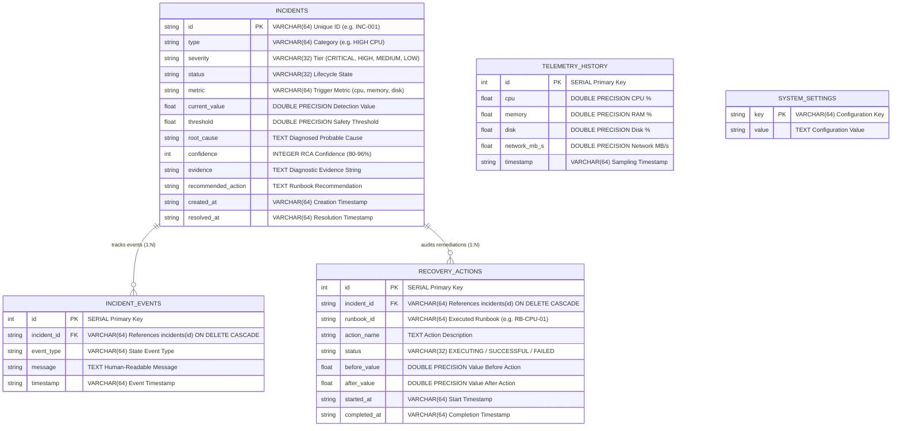

# Database Design Document
## Project: AURA — Autonomous Reliability Agent
**Database Engine:** PostgreSQL 16  
**Target Database:** `aura_reliability_db`  
**Connection Management:** Python `psycopg2` / `psycopg3` with `ThreadedConnectionPool`, RealDictCursor, and SQLAlchemy Declarative ORM (`database.py`, `models.py`)  
**Migrations:** Alembic 1.20.0

---

## 1. Database Overview

AURA uses an enterprise-grade relational **PostgreSQL 16** database configured for high performance, zero-leak connection pooling, and strict relational integrity.

### Connection Pooling & Transaction Management
To ensure robust concurrent operation between frontend telemetry polling, autonomous remediation execution, and sliding-window historical logging, connection handling is managed via a thread-safe connection pool:

- **Connection Pool:** `psycopg2.pool.ThreadedConnectionPool` (min: 1, max: 20 connections) configured with `RealDictCursor` for dictionary row access.
- **Transactional Context Manager (`get_db()`):** Automatically commits transactions on successful block completion, executes `rollback()` on exceptions, and safely returns connections to the pool.
- **Relational Integrity:** Foreign key constraints (`ON DELETE CASCADE`) enforce data consistency across incidents, timeline events, and recovery actions.
- **Alembic Migrations:** Declarative, version-controlled schema migrations under `alembic/versions/`.

---

## 2. Entity-Relationship (ER) Diagram



---

## 3. Detailed Table Schema Definitions

### 3.1 Table: `incidents`
Stores all detected incident records throughout their complete lifecycle.

| Column | Data Type | Constraint | Description |
| :--- | :--- | :--- | :--- |
| `id` | `VARCHAR(64)` | `PRIMARY KEY` | Unique identifier (e.g., `INC-001`, `INC-002`). |
| `type` | `VARCHAR(64)` | `NOT NULL` | Incident category (`HIGH CPU`, `HIGH MEMORY`, `DISK PRESSURE`, `APPLICATION FAILURE`). |
| `severity` | `VARCHAR(32)` | `NOT NULL` | Severity classification (`LOW`, `MEDIUM`, `HIGH`, `CRITICAL`). |
| `status` | `VARCHAR(32)` | `NOT NULL` | Current state (`DETECTED`, `INVESTIGATING`, `REMEDIATING`, `VERIFYING`, `RESOLVED`, `FAILED`). |
| `metric` | `VARCHAR(64)` | `NOT NULL` | The monitored metric triggering the incident (`cpu`, `memory`, `disk`, `app_health`). |
| `current_value` | `DOUBLE PRECISION` | `NOT NULL` | Metric value at time of detection (e.g., `94.2`). |
| `threshold` | `DOUBLE PRECISION` | `NOT NULL` | Safety threshold at time of detection (e.g., `80.0`). |
| `root_cause` | `TEXT` | `NULLABLE` | Diagnosed cause produced by the RCA engine. |
| `confidence` | `INTEGER` | `NULLABLE` | Confidence percentage of the diagnosis ($80 - 96$). |
| `evidence` | `TEXT` | `NULLABLE` | Diagnostic evidence and threshold telemetry facts. |
| `recommended_action` | `TEXT` | `NULLABLE` | Human-readable runbook recommendation. |
| `created_at` | `VARCHAR(64)` | `NOT NULL` | Detection timestamp string (e.g., `14:20:10`). |
| `resolved_at` | `VARCHAR(64)` | `NULLABLE` | Resolution timestamp string (e.g., `14:20:12`). |

**PostgreSQL Indexes:**
- `CREATE INDEX idx_incidents_status ON incidents(status);`
- `CREATE INDEX idx_incidents_metric ON incidents(metric);`
- `CREATE INDEX idx_incidents_created_at ON incidents(created_at DESC);`

---

### 3.2 Table: `incident_events`
Chronological event stream providing an audit timeline for every state transition in an incident.

| Column | Data Type | Constraint | Description |
| :--- | :--- | :--- | :--- |
| `id` | `SERIAL` | `PRIMARY KEY` | Auto-incrementing unique event ID. |
| `incident_id` | `VARCHAR(64)` | `NOT NULL, REFERENCES incidents(id) ON DELETE CASCADE` | Associated incident ID. |
| `event_type` | `VARCHAR(64)` | `NOT NULL` | Event category (`DETECTION`, `RCA_COMPLETED`, `REMEDIATION_STARTED`, `REMEDIATION_FINISHED`, `VERIFICATION_PASSED`, `VERIFICATION_FAILED`, `ESCALATED`). |
| `message` | `TEXT` | `NOT NULL` | Human-readable log describing the exact transition or result. |
| `timestamp` | `VARCHAR(64)` | `NOT NULL` | Event timestamp string. |

**PostgreSQL Indexes:**
- `CREATE INDEX idx_incident_events_incident_id ON incident_events(incident_id);`

---

### 3.3 Table: `recovery_actions`
Audit log recording every executed recovery action, including pre-remediation and post-remediation metrics for closed-loop verification.

| Column | Data Type | Constraint | Description |
| :--- | :--- | :--- | :--- |
| `id` | `SERIAL` | `PRIMARY KEY` | Auto-incrementing unique recovery action ID. |
| `incident_id` | `VARCHAR(64)` | `NOT NULL, REFERENCES incidents(id) ON DELETE CASCADE` | Associated incident ID. |
| `runbook_id` | `VARCHAR(64)` | `NOT NULL` | Runbook ID executed (e.g., `RB-CPU-01`). |
| `action_name` | `TEXT` | `NOT NULL` | Executed action description. |
| `status` | `VARCHAR(32)` | `NOT NULL` | Outcome (`EXECUTING`, `SUCCESSFUL`, `FAILED`). |
| `before_value` | `DOUBLE PRECISION` | `NULLABLE` | Metric value before remediation was applied. |
| `after_value` | `DOUBLE PRECISION` | `NULLABLE` | Metric value measured during post-remediation verification. |
| `started_at` | `VARCHAR(64)` | `NOT NULL` | Start timestamp string. |
| `completed_at` | `VARCHAR(64)` | `NULLABLE` | Completion timestamp string. |

**PostgreSQL Indexes:**
- `CREATE INDEX idx_recovery_actions_incident_id ON recovery_actions(incident_id);`

---

### 3.4 Table: `telemetry_history`
Sliding window of recent system telemetry snapshots used to populate real-time trend charts in the frontend.

| Column | Data Type | Constraint | Description |
| :--- | :--- | :--- | :--- |
| `id` | `SERIAL` | `PRIMARY KEY` | Auto-incrementing snapshot sequence ID. |
| `cpu` | `DOUBLE PRECISION` | `NOT NULL` | Host CPU utilization percentage. |
| `memory` | `DOUBLE PRECISION` | `NOT NULL` | Host RAM memory utilization percentage. |
| `disk` | `DOUBLE PRECISION` | `NOT NULL` | Host Disk storage utilization percentage. |
| `network_mb_s` | `DOUBLE PRECISION` | `NOT NULL` | Combined network throughput rate in MB/s. |
| `timestamp` | `VARCHAR(64)` | `NOT NULL` | Sampling timestamp string. |

**PostgreSQL Indexes:**
- `CREATE INDEX idx_telemetry_history_id ON telemetry_history(id DESC);`

---

### 3.5 Table: `system_settings`
Key-value store for runtime configurable detection thresholds and autonomous policies.

| Column | Data Type | Constraint | Description |
| :--- | :--- | :--- | :--- |
| `key` | `VARCHAR(64)` | `PRIMARY KEY` | Configuration key (e.g., `cpu_threshold`, `auto_remediation_enabled`). |
| `value` | `TEXT` | `NOT NULL` | String-serialized configuration value. |

#### Default Seeded Configuration (using `ON CONFLICT (key) DO NOTHING`):
- `cpu_threshold`: `"80.0"`
- `memory_threshold`: `"85.0"`
- `disk_threshold`: `"90.0"`
- `auto_remediation_enabled`: `"true"`
- `polling_interval_sec`: `"3.0"`

---

## 4. Realistic Example Data Records

### 4.1 `incidents` Record
```json
{
  "id": "INC-001",
  "type": "HIGH CPU",
  "severity": "CRITICAL",
  "status": "RESOLVED",
  "metric": "cpu",
  "current_value": 94.2,
  "threshold": 80.0,
  "root_cause": "CPU-intensive background worker process",
  "confidence": 94,
  "evidence": "CPU utilization remained at 94.2% (threshold: 80.0%). Sustained execution thread spike detected.",
  "recommended_action": "Execute Runbook RB-CPU-01: Restart CPU-intensive process and throttle worker pool.",
  "created_at": "14:20:10",
  "resolved_at": "14:20:12"
}
```

### 4.2 `incident_events` Records
```json
[
  {
    "id": 1,
    "incident_id": "INC-001",
    "event_type": "DETECTION",
    "message": "Incident detected: CPU utilization (94.2%) exceeded threshold (80.0%)",
    "timestamp": "14:20:10"
  },
  {
    "id": 2,
    "incident_id": "INC-001",
    "event_type": "RCA_COMPLETED",
    "message": "RCA completed: Probable cause 'CPU-intensive background worker process' with 94% confidence.",
    "timestamp": "14:20:10"
  },
  {
    "id": 3,
    "incident_id": "INC-001",
    "event_type": "REMEDIATION_STARTED",
    "message": "Remediation initiated: Selected runbook 'RB-CPU-01'. Executing: Restart CPU-intensive worker process & throttle concurrent tasks",
    "timestamp": "14:20:10"
  },
  {
    "id": 4,
    "incident_id": "INC-001",
    "event_type": "REMEDIATION_FINISHED",
    "message": "Action completed: 'Restart CPU-intensive worker process & throttle concurrent tasks'. Commencing recovery verification measurement...",
    "timestamp": "14:20:11"
  },
  {
    "id": 5,
    "incident_id": "INC-001",
    "event_type": "VERIFICATION_PASSED",
    "message": "✓ RECOVERY SUCCESSFUL: CPU reduced from 94.2% → 42.5% (threshold: 80.0%).",
    "timestamp": "14:20:12"
  }
]
```
